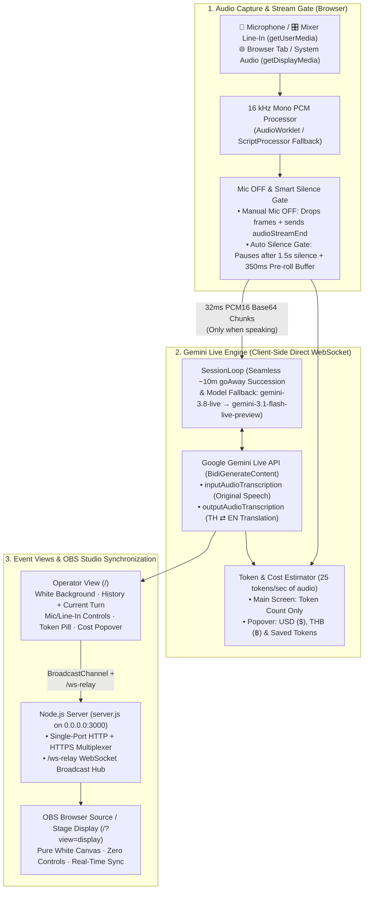

# LiveTranscribe — Thai ⇄ English Event Live Transcription & Translation

An event-ready, minimalist white-background web application for live speech transcription and bidirectional **Thai (`th`) ⇄ English (`en`)** translation powered by the **Gemini Live API** (`gemini-3.8-live`), inspired by [kazunori279/interpretab](https://github.com/kazunori279/interpretab).

---

## System Architecture



---

## How It Works

### 1. Bidirectional Thai ⇄ English Interpretation in One Session
- Connects directly from the operator's browser to Google's `BidiGenerateContent` Live API WebSocket using `gemini-3.8-live` (with automatic fallback to `gemini-3.1-flash-live-preview`).
- Configures both `inputAudioTranscription: {}` and `outputAudioTranscription: {}` alongside a strict two-way interpreter system instruction (`public/lib/instructions.js`):
  - **Speaker speaks Thai (`th`)** → Transcribed in Thai under **Original Speech** and translated into **English** under **Translated Output** (`TH → EN`).
  - **Speaker speaks English (`en`)** → Transcribed in English under **Original Speech** and translated into **Thai** under **Translated Output** (`EN → TH`).
  - Handles code-switching (e.g., Thai sentences containing English technical terms) and custom event glossaries (`Source = Target`).
- Spoken TTS audio output is **muted by default** so event venues and OBS setups never suffer from speaker echo loops, while still streaming the text transcription and translation in real time.

### 2. Cost-Saving Stream Controls (Mic OFF & Smart Silence Gate)
Gemini Live API bills audio at **25 tokens per second of audio**. To prevent paying for silence or breaks between speakers:
- **Manual Mic OFF (`Mic ON/OFF` button or `M` key)**:
  - Immediately stops sending PCM audio frames over the WebSocket (`0 tokens/sec`) while keeping the WebSocket session open for instant unmuting.
  - Sends `{ realtimeInput: { audioStreamEnd: true } }` (Hybrid VAD) to immediately finalize the open turn.
- **Smart Silence Gate (Auto-Pause on Line-In Silence)**:
  - Continuously monitors the RMS/peak level of the incoming Microphone or Mixer Line-In feed.
  - When the input stays below the noise floor for **1.5 seconds** (e.g., when the soundboard mutes the speaker's microphone), it sends `audioStreamEnd: true` and pauses sending audio frames to the API (`0 tokens/sec`).
  - While paused in Silence Gate mode, it maintains a **350ms circular pre-roll buffer** in memory. The instant the speaker begins talking again, the 350ms pre-roll buffer is flushed ahead of the live frames so the first syllable is never clipped.

### 3. Token Counter on Main Screen & Private Cost Estimator Popover
- **Main Screen**: Displays **only** the elapsed clock and total **token count** (e.g., `02:15 · 1,450 tokens`) in the top bar—no dollar or baht price is ever shown on the main screen.
- **API Cost Estimation Popover**: Clicking the token pill opens a popover displaying:
  - Total Billed Tokens (`In` vs `Out` breakdown)
  - Tokens & Time Saved by **Mic OFF** / **Silence Gate**
  - Estimated API Cost in **USD (`$`)** and **THB (`฿`)**, plus hourly run-rate projection (`$/hr` and `฿/hr`).

### 4. Seamless Session Succession (`SessionLoop`)
- Gemini Live API WebSocket connections have a ~10-minute lifetime and emit a `goAway` frame ~50 seconds before closing.
- `public/lib/session-loop.js` automatically opens a replacement WebSocket in the background as soon as `goAway` arrives, waits for a natural turn boundary (or idle grace window), swaps sessions seamlessly, and replays any unanswered pre-roll audio so multi-hour conferences run without interruption.

### 5. Single-Port HTTP + HTTPS Multiplexing (`server.js`)
- Browsers require a **Secure Context** (`https://` or `http://localhost`) to enable `navigator.mediaDevices.getUserMedia` and `AudioWorklet`.
- `server.js` inspects the first byte of every incoming TCP connection on port `3000`:
  - **Localhost (`http://localhost:3000/`)** works directly over HTTP.
  - **LAN IP (`http://192.168.x.x:3000/`)** automatically redirects (`302`) to **`https://192.168.x.x:3000/`** on the same port using an auto-generated SAN certificate so Microphone/Line-In capture works across the network.
  - **OBS Display View (`http://<host>:3000/?view=display`)** is served directly over plain HTTP without redirecting so OBS Browser Sources never hit certificate warnings.

---

## Quick Start & Deployment

### Prerequisites
- **Node.js** `>= 20.0.0` (zero external `npm` dependencies required)
- A **Gemini API Key** from [Google AI Studio](https://aistudio.google.com/apikey)

### Run the Server
```bash
git clone git@github.com:fonylew/livetranscribe.git
cd livetranscribe
HOST=0.0.0.0 PORT=3000 npm start
```

### Run Automated Tests
```bash
npm test
```

---

## Using with OBS Studio & Mixer Line-In

1. **Open the Operator View in Chrome / Edge**:
   - On the same machine: `http://localhost:3000/`
   - From another laptop on the LAN: `https://<server-ip>:3000/`
2. **Configure Audio & API Key**:
   - Click **Settings**, paste your **Gemini API Key**, and enable **Line-In / Mixer Direct Mode** if capturing from a soundboard or audio interface (disables browser AGC/AEC/NS for clean mixer feeds).
   - Select your **Line-In / Audio Interface / Virtual Audio Cable** (or **Browser Tab / System Audio**) in the top bar dropdown.
   - Click **Start Session**.
3. **Add to OBS Studio**:
   - In OBS Studio, add a **Browser** source (`+` → **Browser**).
   - Set **URL** to: `http://localhost:3000/?view=display` *(or `http://<server-ip>:3000/?view=display`)*.
   - Set **Width** to `1920` and **Height** to `1080` (full screen) or `450` (lower-third banner).
   - The `?view=display` page renders a pure `#FFFFFF` white background with history and the current live transcription, automatically synchronized in real time via `/ws-relay`.

---

## Project Structure

```text
livetranscribe/
├── package.json                         # Scripts and package metadata (zero external deps)
├── server.js                            # Single-port HTTP/HTTPS server + /ws-relay hub for OBS
├── public/
│   ├── index.html                       # Operator UI & OBS Display View (?view=display)
│   ├── styles.css                       # Minimalist white theme & responsive bilingual layout
│   ├── app.js                           # Audio capture, Mic Off/Silence Gate, UI & OBS sync
│   ├── audio/
│   │   ├── pcm-recorder-processor.js    # 16 kHz mono AudioWorklet recorder
│   │   └── pcm-player-processor.js      # 24 kHz ring-buffer AudioWorklet player
│   └── lib/
│       ├── instructions.js              # Bidirectional TH ⇄ EN system instruction & glossary
│       ├── live-session.js              # Direct Gemini Live WebSocket client & preflight check
│       ├── session-loop.js              # Seamless goAway session rotation & model fallback
│       └── usage.js                     # Token counter (main screen) & API cost estimator (popover)
└── tests/
    └── livetranscribe.test.js           # Unit & integration tests (server, relay, Live API, usage)
```
