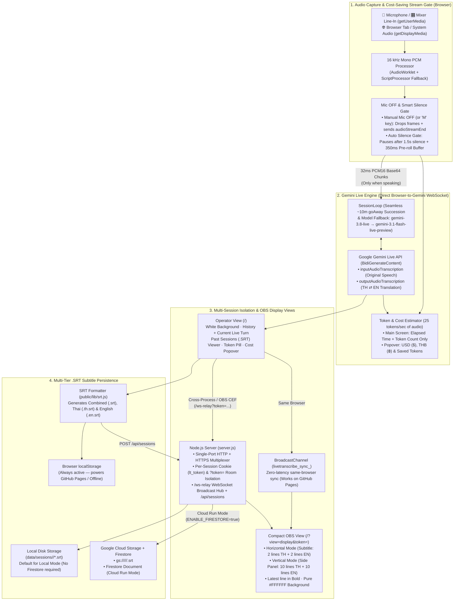

# LiveTranscribe — Thai ⇄ English Event Live Transcription & Translation

An event-ready, minimalist white-background web application for live speech transcription and bidirectional **Thai (`th`) ⇄ English (`en`)** translation powered by the **Gemini Live API** (`gemini-3.8-live`), inspired by [kazunori279/interpretab](https://github.com/kazunori279/interpretab).

---

## System Architecture



---

## Architecture Breakdown

### 1. Bidirectional Thai (`th`) ⇄ English (`en`) Interpretation
- Connects directly from the browser to Google's `BidiGenerateContent` Live API WebSocket using `gemini-3.8-live` (with automatic fallback to `gemini-3.1-flash-live-preview`).
- Enables both `inputAudioTranscription: {}` and `outputAudioTranscription: {}` with a two-way interpreter system instruction ([`public/lib/instructions.js`](file:///home/aimet/projects/livetranscribe/public/lib/instructions.js)):
  - **Speaker speaks Thai** → Transcribed in Thai and translated into English (`TH → EN`).
  - **Speaker speaks English** → Transcribed in English and translated into Thai (`EN → TH`).
- Spoken TTS audio playback is muted by default to prevent venue feedback loops while streaming text transcriptions in real time.

### 2. Cost-Saving Stream Gate (Mic OFF & Smart Silence Gate)
Gemini Live API bills audio at **25 tokens per second of audio**. To save money during pauses or breaks:
- **Manual Mic OFF (`Mic ON/OFF` button or `M` key)**: Immediately drops outgoing audio frames (`0 tokens/sec`) and sends `{ realtimeInput: { audioStreamEnd: true } }` to finalize the open turn while keeping the WebSocket warm.
- **Smart Silence Gate**: Monitors peak audio levels and automatically sends `audioStreamEnd: true` after **1.5 seconds of silence**, holding a **350ms circular pre-roll buffer** in memory so the first syllable is never clipped when speech resumes.
- **Token Pill vs. Cost Popover**: The main screen displays **only** the elapsed time and **token count** (`0 tokens`). Clicking the token pill opens the private **API Cost Estimation** popover with USD (`$`), THB (`฿`), hourly projections, and tokens saved.

### 3. Multi-Session Isolation (`lt_token` Cookie & `?token=...`)
- Multiple operators or stages can use the same server or Cloud Run deployment concurrently:
  - [`server.js`](file:///home/aimet/projects/livetranscribe/server.js) issues a unique `lt_token` cookie per browser and scopes both `/ws-relay` WebSocket rooms and saved `.srt` sessions by `clientToken`.
  - Opening `/?view=display` in the **same browser** pairs automatically via the `lt_token` cookie; opening inside **OBS Studio's Browser Source** pairs via `/?view=display&token=<lt_token>`.

### 4. Multi-Tier `.SRT` Subtitle Persistence
- Every finalized turn is formatted into SubRip (`.srt`) format ([`public/lib/srt.js`](file:///home/aimet/projects/livetranscribe/public/lib/srt.js)) in three variants: **Combined Bilingual** (`.srt`), **Thai Only** (`.th.srt`), and **English Only** (`.en.srt`).
- **3 Storage Tiers**:
  1. **Browser `localStorage`**: Always active (even on static **GitHub Pages**).
  2. **Local Disk (`./data/sessions/<lt_token>/`)**: Active whenever running `server.js` locally (`./deploy.sh --local` or `npm start`)—no Firestore or GCP setup required.
  3. **Google Cloud Storage (`GCS_BUCKET`) + Firestore (`ENABLE_FIRESTORE=true`)**: Automatically provisioned and enabled when deployed to **Google Cloud Run** via [`./deploy.sh`](file:///home/aimet/projects/livetranscribe/deploy.sh).

---

## Step-by-Step OBS Studio Setup Guide

### Step 1: Connect Your Audio Source (Microphone, Mixer Line-In, or System Audio)
1. Open the **Operator View** in Chrome or Edge:
   - **Local**: `http://localhost:3000/` *(or `https://<lan-ip>:3000/` from another laptop on the LAN)*
   - **Cloud Run**: `https://<your-cloud-run-service>.a.run.app/`
2. If you are feeding audio from a **soundboard, mixer Line-In, USB audio interface, or Virtual Audio Cable** (e.g. VB-Cable / BlackHole):
   - Click **Settings** (top right) and check **Line-In / Mixer Direct Mode** (disables browser Echo Cancellation, Noise Suppression, and Auto-Gain Control so clean mixer audio is preserved).
   - Select your audio interface in the top-bar **Audio Input / Line-In** dropdown (or select **🌐 Browser Tab / System Audio** to capture audio from another tab/application).
3. Enter your **Gemini API Key** in **Settings** (or configure `GEMINI_API_KEY` in `.env` so it loads automatically) and click **Start Session**.

---

### Step 2: Copy Your Paired OBS View URL
1. In the Operator View, click **Settings** and locate **OBS Browser Source URL (Paired with this Session)**, then click **Copy URL** (or right-click the **OBS View** button in the top bar and copy its link):
   ```text
   http://localhost:3000/?view=display&token=lt_xxxxxxxxxxxxxxxx
   ```
   *(Using `?token=...` guarantees that OBS Studio's isolated Browser Source pairs with your specific browser session even when multiple sessions are running simultaneously.)*

---

### Step 3: Add the Browser Source in OBS Studio (Horizontal vs. Vertical)

The OBS View (`?view=display`) renders a compact, high-contrast `#FFFFFF` white display with **Thai** on top, a `----------` divider, **English** below, and the **latest line in bold**:

```text
Thai
(14:05:01) สวัสดีครับทุกท่าน ยินดีต้อนรับเข้าสู่งานสัมมนา
(14:05:08) **ในเซสชันนี้เราจะมาสำรวจล่าม AI แบบเรียลไทม์**
----------
English
(14:05:01) Hello everyone, welcome to our conference.
(14:05:08) **In this session we will explore real-time AI interpretation.**
```

In OBS Studio, click **`+`** under **Sources** → select **Browser**, and configure one of the two layouts:

#### Option A: Horizontal Subtitle / Lower-Third Layout (Bottom of Screen)
Shows the **latest 2 lines of Thai** and **latest 2 lines of English** with the newest text in **bold**:
- **URL**: Paste your copied `?view=display&token=...` URL (optionally append `&obsLayout=horizontal`)
- **Width**: `1920`
- **Height**: `320` (or `280`–`380`)
- Position the Browser Source at the bottom of your 16:9 OBS canvas as a live bilingual subtitle bar.

#### Option B: Vertical Side-Panel History Layout (Side of Screen)
Shows up to **10 lines of Thai** and **10 lines of English** history with the newest text in **bold**:
- **URL**: Paste your copied `?view=display&token=...` URL (optionally append `&obsLayout=vertical`)
- **Width**: `480` (or `420`–`560`)
- **Height**: `1080`
- Dock the Browser Source on the left or right side of your OBS scene beside the speaker camera or presentation slides.

> **Tip**: You can also switch the OBS layout (`Auto`, `Horizontal`, `Vertical`) and adjust **Display Font Size (`70%`–`200%`)** live from the Operator's **Settings** popover—changes sync to OBS immediately.

---

## Deployment Options

### Option 1: Google Cloud Run + GCS Bucket + Firestore (`./deploy.sh`)
Provisions the Cloud Storage bucket for `.srt` files, creates the Cloud Firestore database (for Cloud deployment), and deploys the container to Cloud Run with `--session-affinity`:

```bash
# 1. Preview the exact gcloud commands (--dry-run)
./deploy.sh --project=YOUR_GCP_PROJECT_ID --region=asia-southeast1 --dry-run

# 2. Execute full Cloud Run deployment
./deploy.sh --project=YOUR_GCP_PROJECT_ID --region=asia-southeast1
```

### Option 2: Local Deployment (No Firestore Required)
Runs on `0.0.0.0:3000` (with single-port HTTP + HTTPS multiplexing for LAN microphone access) and saves `.srt` files directly to local disk (`./data/sessions/`) without requiring Firestore:

```bash
./deploy.sh --local
# or:
npm start
```

### Option 3: GitHub Pages (100% Static / Serverless Hosting)
Yes—**LiveTranscribe can also be deployed on GitHub Pages!**
Because the Gemini Live WebSocket client, AudioWorklet processors, and `.SRT` generator in [`public/`](file:///home/aimet/projects/livetranscribe/public/) are pure browser ES modules with relative asset paths and a `localStorage` session store fallback:
- A GitHub Actions workflow is included at [`.github/workflows/pages.yml`](file:///home/aimet/projects/livetranscribe/.github/workflows/pages.yml).
- To enable it: in your GitHub repository, go to **Settings → Pages → Build and deployment → Source** and select **GitHub Actions**. Every push to `main` will automatically publish `public/` to `https://<username>.github.io/<repo>/`.

| Capability | Cloud Run (`./deploy.sh`) | Local (`./deploy.sh --local`) | GitHub Pages (Static) |
| :--- | :---: | :---: | :---: |
| **TH ⇄ EN Live Transcription & Translation** | ✅ | ✅ | ✅ |
| **Mic OFF & Smart Silence Gate** | ✅ | ✅ | ✅ |
| **Past Sessions & `.SRT` Download in UI** | ✅ (Server + GCS + Firestore) | ✅ (Local `data/sessions/*.srt`) | ✅ (Browser `localStorage`) |
| **`.env` Default `GEMINI_API_KEY`** | ✅ | ✅ | Manual entry in UI Settings |
| **OBS Sync (Same Browser / Window Capture)** | ✅ (`BroadcastChannel` + `/ws-relay`) | ✅ (`BroadcastChannel` + `/ws-relay`) | ✅ (`BroadcastChannel`) |
| **OBS Studio Embedded Browser Source Sync** | ✅ (`/ws-relay?token=...`) | ✅ (`/ws-relay?token=...`) | Run via OBS *Interact* or use Local/Cloud Run |

---

## Project Structure

```text
livetranscribe/
├── deploy.sh                            # Automated Cloud Run (GCS + Firestore) & Local deployment script
├── Dockerfile                           # Production container image for Google Cloud Run
├── .gcloudignore                        # Excludes local data/, .env, and node_modules from Cloud Build
├── .env.example                         # Example .env configuration
├── .github/workflows/pages.yml          # Automated GitHub Pages deployment workflow
├── package.json                         # Scripts and package metadata (zero external deps)
├── server.js                            # HTTP/HTTPS server, cookie/token rooms, /api/sessions & /ws-relay
├── lib/
│   ├── env.js                           # Zero-dependency .env parser and loader
│   └── storage.js                       # SessionStore: Local .SRT + Google Cloud Storage + Firestore
├── public/
│   ├── index.html                       # Operator UI, Past Sessions (.SRT) modal & Compact OBS Stage
│   ├── styles.css                       # Minimalist white theme + Vertical/Horizontal OBS styles
│   ├── app.js                           # Audio capture, Silence Gate, OBS renderer & session persistence
│   ├── audio/
│   │   ├── pcm-recorder-processor.js    # 16 kHz mono AudioWorklet recorder
│   │   └── pcm-player-processor.js      # 24 kHz ring-buffer AudioWorklet player
│   └── lib/
│       ├── instructions.js              # Bidirectional TH ⇄ EN system instruction & glossary
│       ├── live-session.js              # Direct Gemini Live WebSocket client & preflight check
│       ├── session-loop.js              # Seamless goAway session rotation & model fallback
│       ├── srt.js                       # SubRip (.srt) timestamp & bilingual/single-lang formatter
│       └── usage.js                     # Token counter (main screen) & API cost estimator (popover)
└── tests/
    └── livetranscribe.test.js           # Unit & integration tests (SRT, GCS/Firestore, multi-session, Live API)
```
